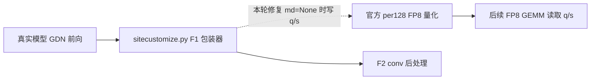

# Claude FP8 实验接手施工交工单

独立性: 本交工单由独立 Sol reviewer 根据已保存的源码、原始请求、GPU 记录和本地 CPU 复算生成；reviewer 未连接服务器，也未运行 GPU 或改动实现。

## 总结

本轮按《Claude FP8 experiment takeover》接手中断的 A/D/P/F 实验，核清旧结论，修复 F1 融合路径一个可复现的输出缓冲缺陷，并在真实 FP8 模型上做新的三臂对照；还实际构建并测量了两种先前未测的 SM120 FP8 GEMM。修复后的 F1/F2 在本轮长 prefill 请求中约省 1.49% 首字耗时，生成吞吐没有有意义提升；历史 F1/F2 合用时回答分叉的唯一原因仍无法确定，因此只保留实验候选，未部署。两种新 GEMM 均未达到预设的 10% 单算子收益门槛，原 block128 权重格式与模型配置保持不变。embedding 始终保留运行，原 27B、9B、ASR 保持停止。

## 目标对账

| 原任务目标 | 状态 | 实际效果与限制 |
| --- | --- | --- |
| 恢复 Claude 已做的 A/D/P/F 工作，辨明实测与计划 | 完成 | 对收到的 7,437 个文件建哈希清单；A 的已有 GEMM ceiling、D 的固定词表投机解码、P 的 V2 长 prefill 与 F 的旧对照分别核对。D5/D6 和更广的 P 优化仍是后续计划，没有被本轮当成已完成。 |
| 解释或约束 F1/F2 合用时的输出差异，并完成受控验证 | 部分完成 | 旧合用臂六条长 decode 正文都与对照不同；发现并修复 `md=None` 分支未写 q/s 的确定缺陷。新无诊断整模对照六条 decode 正文及逐条投机接受计数均一致，12 条长 prefill 配对首字耗时中位减少 1.4896%。旧异常的唯一因果仍未证实，业务质量和长时间运行未验收。 |
| 对官方 block128、CUTLASS SM120 MXFP8、FlashInfer #5521 派生 rowwise 做随机数据比较 | 完成实验，未采用新格式 | 两个新内核均实际编译，数值、尾块与换输入图回放通过。M=2,741/16,160 各做 31 组随机配对；稳态大 M 时 MXFP8 为官方的 0.9726 倍速度，PR 派生为 1.0478 倍，均低于 1.10 门槛。它们的 scale 格式与原模型不同，尚无原权重转换和模型质量结果。 |
| 保护现有服务、模型精度边界与接手文件 | 完成所观测窗口 | 原 FP8 权重、FP8 KV、MTP4、BF16 输出 head 未改；embedding 最终两次实际请求均返回 200 和 1,024 维有限向量，容器身份及重启计数未变。另三项服务仍停止，实验容器已清理；继承的 `.gitignore` 修改及 Claude 未提交文件保留。 |
| 通过单一代理主连接串行操作 GPU | 完成所观测窗口 | 控制命令要求复用一个 OpenSSH master，子连接不允许自动开新代理连接；本机代理接口在 11:07:24 UTC 观察到目标一条 TCP 连接和主进程 PID 68704。该快照不能证明全程每一刻的连接数。 |

## 施工细节

**F1/F2 接入。** F1 把 gated RMSNorm 与 per128 FP8 量化合在一起，F2 合并 causal conv 与后处理。旧包装器在 `md=None` 预热路径直接返回，留下将被 GEMM 读取的 q/s 缓冲未初始化；[sitecustomize.py](../f-mdnone-fix/sitecustomize.py) 现在按官方路径先写 FP8 字节和 FP32 scale 再返回。实际 CUDA poison 检查在 M=1、256、32768 均看到旧分支保留 NaN，新分支与官方结果逐位一致；这个检查把 packed warmup 换成了明确的无状态 stub，不能称作真实预热、图或整模测试。真正整模证据来自随后未插入参考计算的 A1/B/A2：相同冻结镜像与模型，只把 `PRO6000D_F_ENABLE` 从空值改为 `norm,conv` 再改回空值。B 的服务日志出现 fused 首次执行标记、编译 splitting op 和图捕获成功；未保存每次调用的 direct/replay 轨迹。三臂按相同请求的前后基线均值配对，12/12 长 prefill 更快；A2 相对 A1 同时漂移 +0.8228%，故 1.4896% 只代表该窗口。六条长 decode 正文及逐条 drafts/accepted 一致，decode TPS 变化 +0.0076%。历史异常在带诊断、但尚未补这个缺陷的运行中也恢复一致；诊断插入了参考计算、clone 和同步，因此不能把旧分叉单因归给该缺陷。



**新 GEMM。** 对照是 `A[M,5120] × W[34816,5120]ᵀ → BF16[M,34816]`，M 为 2,741 或 16,160。官方臂用原 block128 FP32 scale；CUTLASS MXFP8 使用 K32 幂二 scale；PR #5521 派生臂与 cuBLAS 对照用逐行/逐输出通道 scale。原 #5521 针对另一个 MiniMax-H3 融合算子，本轮从固定源码派生适配尺寸及 canonical gate/up BF16 输出的 GEMM，并非直接调用其通用接口。生成器锁定源码哈希，首版 CUTLASS 编译缺一个固定头文件，补齐后两库均编译成功。第二轮在正式计时前至少 15 秒轮转预热，逐 M 做四臂 31 组随机配对、warm 与自有大缓冲扰缓存；大 M 的 cuBLAS rowwise/新 MXFP8/PR 派生相对官方配对加速比分别为 1.0670/0.9726/1.0478，小 M 分别为 1.0374/0.9503/1.0377。PR 派生与同输入 cuBLAS rowwise 的完整矩阵 BF16 比较无 bit 差异；MXFP8 与独立 K32 参考数值接近。两种 scale 语义不同，不能把这个数值检查解释为与现有模型等价。测量只包 GPU GEMM/图回放；输入量化、权重转换与预排、host TMA descriptor 均未计入。功率和时钟有观测但未锁定或归一，扰缓存也不保证完全冷缓存。没有达到 10% 门槛，所以未转换权重或接进模型。

**服务与文件。** 控制器在每个实验前后检查服务，只操作自己精确命名的容器；实验期间 embedding 保持运行，F 修复版 `ffix-v1` 整模三臂窗口记录的 53 次健康样本均为 200。最终相隔 37.34 秒的两次 embedding 向量请求仍通过，原 27B、9B、ASR 未启动，GPU 清单只剩 embedding EngineCore。接手时未提交的 Claude 文件与 `.gitignore` 原有修改仍留在工作树。单主连接策略使用临时 loopback SOCKS 与既有 PROXY 组，子命令指定相同 ControlPath 并禁止代理回退；本机代理和 master 检查证明了一个时间点的连接状态。

## 验证情况

本地 CPU 从原始 JSONL 重新计算了旧 F 分叉、新整模三臂和第二轮 GEMM 配对结果；新整模正式记录为每臂 12 条 prefill、6 条 decode，GEMM 每个 M/模式有 31 组四臂数据。模型测试还包含 5 个合成质量项与 4 个开放输出项：后者的输入和文本 hash 一致，前者原脚本没保存输入 hash，不能声称输入字节已逐项对齐。没有真实 MoBase 业务、并发、长期可用性、模型权重换格式后的质量或端到端新 GEMM 收益验证。

## 后续与复现

后续若继续 F1/F2，应在隔离窗口补真实业务、长上下文、并发与更长运行的质量/性能检查，并保存每条质量输入 hash 和更细的融合调用见证；在此之前不要把小幅 prefill 收益当作生产加速。旧合用臂分叉原因仍有未排除的编译或运行安排因素。若再研究 GEMM，需要先说明新 scale 的原权重转换、输入量化、预排和 host descriptor 成本，再验证质量；本轮两臂的单算子结果不支持更改模型格式。

在本仓库根目录可用 CPU 重算新整模对照，输出另存临时文件，不覆盖原始记录：

```sh
python3 _dev/docs/evidence/sm120-next/takeover/analyze_ffix_aba.py \
  --root _dev/docs/evidence/sm120-next/takeover/ffix-v1 \
  --output /tmp/ffix-recomputed.json
```

要重跑 GPU，前置条件是在现有服务器保留固定 vLLM 0.31 / torch 2.13 cu130 镜像、原 FP8 模型与旧控制器、CUTLASS 4.5.0 头文件，以及三份实验库：F 三臂所用 `f-mdnone-fix/v2/libfp8_silu_quant.so`（SHA256 `087b7caa92c4742ece3875b6dd1421e25360b834ce4106f7fa166f90bc933b3f`），GEMM 所用 `b-mxfp8-recovery/build-mxfp8/librecovery_mxfp8.so` 与 `build-pr5521/libpr5521_derived.so`。现有服务器已提供这些库；二进制没有入仓，换环境时须按构建记录重建或提供并校验。先人工确认 embedding 正常、原三服务仍关闭且无其它实验容器，只用既有代理 SSH ControlPath，不让子命令回退建新 TCP；一次只跑一个任务。将新脚本与所需源码同步到服务器已有 `/home/llm/.local/share/qwen-sm120-takeover`，选择此前不存在的新标签（以下 `v3` 仅示例，若已存在则改用更大编号），执行：

```sh
cd /home/llm/.local/share/qwen-sm120-takeover
python3 run_f_fixed_aba.py --label ffix-v3
# 等上一个任务的 status.json 为 completed、所有本轮容器退出后，再运行：
python3 run_gemm_steady.py --label gemm-v3
```

两个启动器会后台运行，先看其输出的 PID/目录，再检查新目录 `status.json`，只有 `state=completed` 且所有 arm 成功才分析结果；不要并发启动。整模数据可复制到本地用上面的分析器，GEMM 查看各 `m2741.jsonl`、`m16160.jsonl` 的数值/Graph gate、31 组计时与 NVML 样本。现有原始数据分别在 [F 三臂目录](../ffix-v1)、[GEMM 第二轮目录](../gemm-v2)；结论与边界在 [接手报告](../../../../18-claude-fp8-takeover.md)，服务最终记录在 `takeover/services-final-1.json`、`services-final-2.json` 和 `inventory-final.json`。
